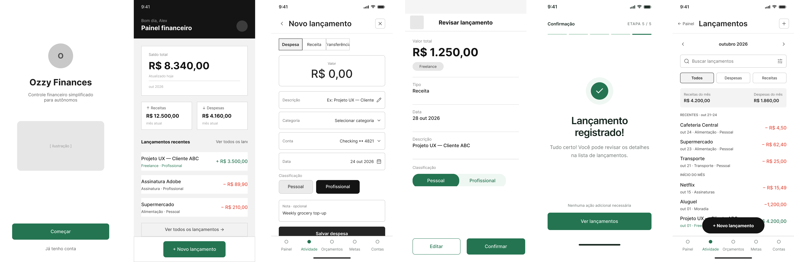

# Ozzy Finances

**Controle financeiro simples e inteligente para pequenos empreendedores.**

## 🔗 Projeto

**Protótipo público no Figma:** [Clique aqui para acessar o projeto no Figma](https://www.figma.com/design/minmAsWlUjASLpezBSUrH2/Ozzy-Finances---UX?node-id=0-1&t=7qeqmUicc2uwPJsq-1)

## 🎯 Objetivo do produto

O **Ozzy Finances** é uma proposta de assistente financeiro com inteligência artificial, desenvolvido para MEIs, profissionais autônomos e pequenos prestadores de serviços.

O objetivo é simplificar o controle financeiro, permitindo registrar e organizar receitas e despesas, diferenciar movimentações pessoais e profissionais e transformar os registros em informações úteis para a tomada de decisões.

A solução busca reduzir as dificuldades relacionadas ao controle manual ou irregular das finanças, oferecendo uma experiência simples, acessível e adequada à rotina dos pequenos empreendedores.

## 🔄 Fluxo principal

O protótipo mobile foi desenvolvido no Figma, considerando uma resolução de referência de **390 × 844 px**.

A jornada principal é composta por seis telas:

1. **Boas-vindas:** apresenta o produto e permite iniciar a experiência.
2. **Painel financeiro:** exibe uma visão resumida do saldo, receitas, despesas e lançamentos recentes.
3. **Novo lançamento:** permite informar os dados de uma receita ou despesa.
4. **Revisão:** apresenta as informações preenchidas para conferência e permite retornar à edição.
5. **Confirmação:** comunica que o lançamento foi concluído.
6. **Lista de lançamentos:** permite consultar o histórico de movimentações.

**Fluxo de navegação:**

`Boas-vindas → Painel financeiro → Novo lançamento → Revisão → Confirmação → Lista de lançamentos`

O protótipo também contempla caminhos alternativos, como acesso direto à lista pelo painel e retorno à edição durante a revisão.

## 🎨 Decisões de design

A concepção da interface priorizou simplicidade, clareza visual e facilidade de utilização em dispositivos móveis.

### UX — Experiência do usuário

- Organização das telas por objetivos específicos.
- Painel financeiro definido como ponto central da aplicação.
- Registro de movimentações dividido em etapas.
- Etapa de revisão para facilitar a identificação e correção de erros.
- Ações e textos objetivos para orientar a navegação.
- Jornada estruturada para reduzir o esforço durante o registro financeiro.

### UI — Interface visual

- **Paleta de cores:** predominância de verde, branco e cinza, transmitindo organização e confiança.
- **Tipografia:** utilização da família Inter para manter legibilidade e hierarquia visual.
- **Componentes:** cartões financeiros, botões, campos de entrada e elementos de navegação padronizados visualmente.
- **Identificação financeira:** diferenciação visual entre receitas e despesas.
- **Linguagem:** textos revisados para utilizar português brasileiro e termos familiares ao público.
- **Layout:** abordagem mobile-first, utilizando cartões, espaçamentos e elementos visuais organizados.

## 📌 Escopo do protótipo

O projeto representa uma proposta de experiência e interface UX/UI, com foco na demonstração da jornada principal do usuário.

As telas e interações desenvolvidas no Figma permitem visualizar a navegação planejada. O protótipo não representa, por si só, a implementação de funcionalidades de produção, integrações financeiras ou processamento de inteligência artificial.

---

**Ozzy Finances — Seu negócio em ordem, suas decisões mais claras.**

---

## Artefatos de Projeto

- [Projeto Figma](https://www.figma.com/design/minmAsWlUjASLpezBSUrH2/Ozzy-Finances---UX?node-id=0-1&t=7qeqmUicc2uwPJsq-1)
- [Demonstração do Protótipo no YouTube](https://www.youtube.com/watch?v=xrvYHwoZ_EE)
- [Discussões e Análises](./pdfs/discussions.pdf)
